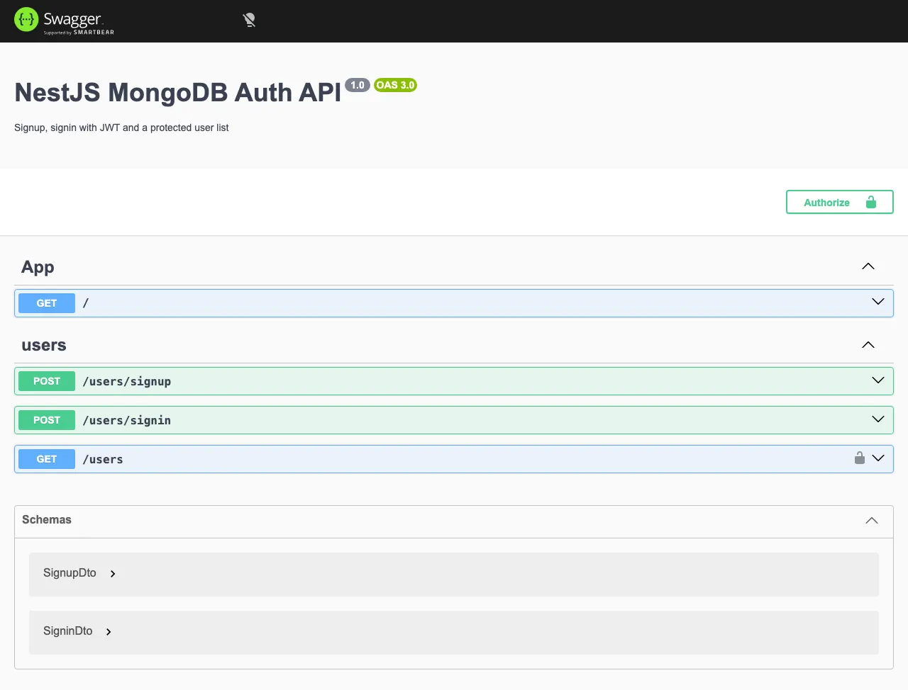
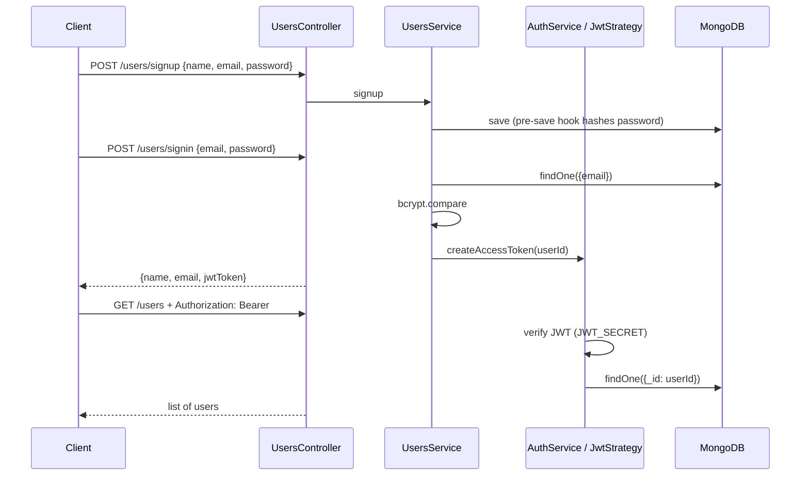
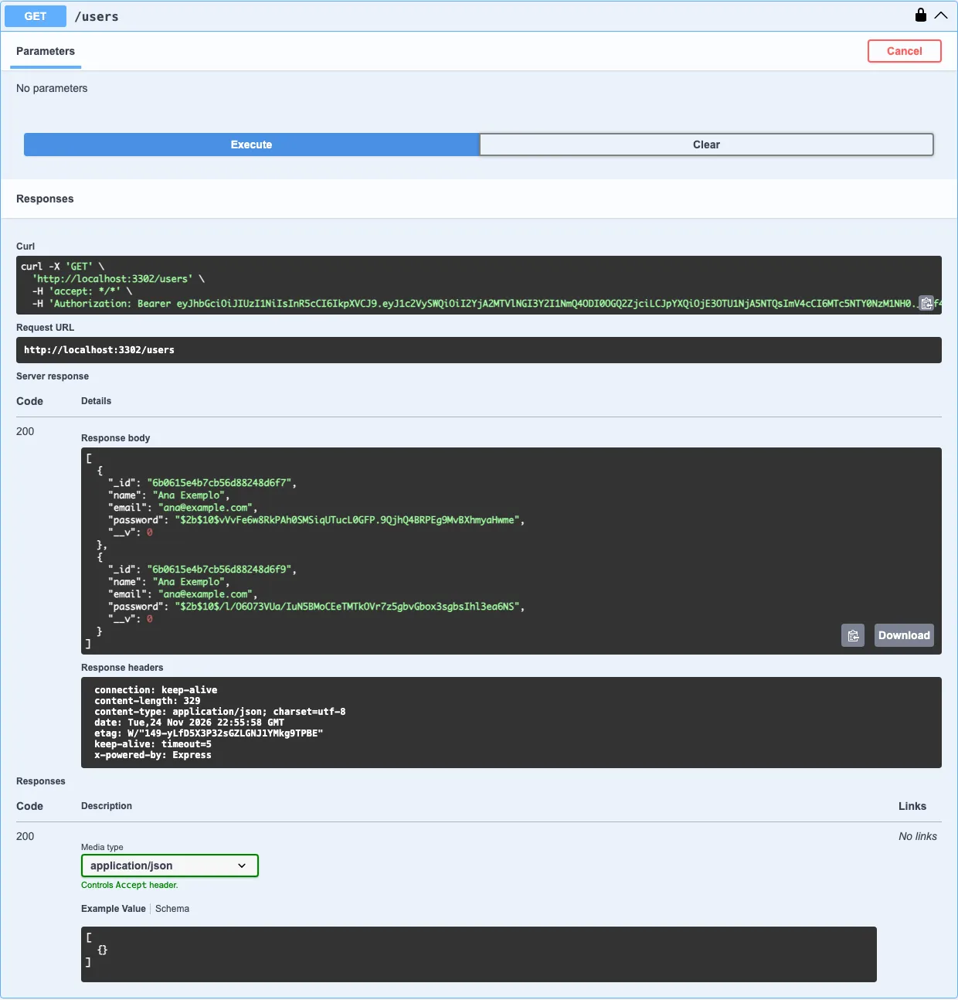

# NestJS MongoDB Auth API

A small NestJS REST API for user sign-up and sign-in with JWT. Users are stored in MongoDB through Mongoose, and one route is protected by a Passport JWT guard.



## Features

- `POST /users/signup` stores a user. A Mongoose `pre('save')` hook hashes the password with bcrypt (10 rounds).
- `POST /users/signin` checks the password with `bcrypt.compare` and returns a JWT signed with `JWT_SECRET` (payload `{ userId }`).
- `GET /users` is protected by `AuthGuard('jwt')`: the strategy reads `Authorization: Bearer <token>`, verifies it and loads the user from MongoDB.
- Body validation with `class-validator` through a global `ValidationPipe` (valid email, password with at least 4 characters).
- Swagger UI at `/docs`.

## How it works



User document (`src/users/schemas/users.schema.ts`): `name`, `email`, `password` (bcrypt hash). All three are plain `String` fields with no `required` or `unique` constraint.

## Stack

NestJS 11, TypeScript, MongoDB + Mongoose 8, Passport (`passport-jwt`), `jsonwebtoken`, bcrypt, class-validator, @nestjs/swagger, Jest.

## Running locally

Prerequisites: Node.js 20+ and a MongoDB instance (for example `docker run -d --name mongo -p 27017:27017 mongo:7`).

```bash
npm install
cp .env.example .env
npm run start:dev          # http://localhost:3001
```

| Variable | Example (`.env.example`) | Purpose |
| --- | --- | --- |
| `MONGO_URI` | `mongodb://localhost:27017/nestjs-auth` | connection string (default `mongodb://localhost:27017/defaultdb`) |
| `JWT_SECRET` | `change-me` | signs and verifies tokens. Set it (see Known limitations) |
| `JWT_EXPIRATION` | `1d` | token lifetime. Required: sign-in returns 500 without it |
| `PORT` | `3001` | API port (default 3001) |

Production build: `npm run build && npm run start:prod`.

## API

| Method | Route | Auth | Description | Responses |
| --- | --- | --- | --- | --- |
| GET | `/` | - | hello world | 200 |
| POST | `/users/signup` | - | create user (`name`, `email`, `password`) | 201, 400 |
| POST | `/users/signin` | - | returns `{ name, email, jwtToken }` | 200, 400, 404 |
| GET | `/users` | Bearer JWT | list all users | 200, 400 (no header), 401 |

Real output with fictional data:

```text
$ POST /users/signup  {"name":"Ana Exemplo","email":"ana@example.com","password":"senha123"}
{"name":"Ana Exemplo","email":"ana@example.com","password":"$2b$10$vVvFe6w8…","_id":"6b0615e4b7cb56d88248d6f7","__v":0}
$ POST /users/signup  {"name":"X","email":"nope","password":"1"}
{"message":["email must be an email","password must be longer than or equal to 4 characters"],"error":"Bad Request","statusCode":400}
$ POST /users/signin  {"email":"ana@example.com","password":"senha123"}
{"name":"Ana Exemplo","jwtToken":"eyJhbGciOi…","email":"ana@example.com"}
$ POST /users/signin  (wrong password)
{"message":"Password NOT FOUND","error":"Not Found","statusCode":404}
$ GET /users  (no Authorization header)
{"message":"BAD REQUEST","error":"Bad Request","statusCode":400}
$ GET /users  (Authorization: Bearer abc)
{"message":"Unauthorized","statusCode":401}
```

API documentation:

- Swagger UI: `http://localhost:3001/docs` (JSON at `/docs-json`). Paste the `jwtToken` from sign-in into **Authorize** to call `GET /users`.
- OpenAPI 3 file: [`docs/openapi.json`](docs/openapi.json), exported from `/docs-json`. Open it in [editor.swagger.io](https://editor.swagger.io).
- Postman: import [`docs/postman/nestjs-mongodb-auth-api.postman_collection.json`](docs/postman/nestjs-mongodb-auth-api.postman_collection.json). `baseUrl` defaults to `http://localhost:3001`, and "Sign in" saves the token in `token` for "List users".



## Project structure

```
src/
├── main.ts                     # ValidationPipe, Swagger at /docs
├── app.module.ts               # MongooseModule.forRoot(MONGO_URI)
├── auth/
│   ├── auth.service.ts         # sign token, validate user, Bearer extractor
│   ├── strategies/jwt.strategy.ts
│   └── models/jwt-payload.model.ts
└── users/
    ├── users.controller.ts     # signup, signin, GET /users
    ├── users.service.ts
    ├── dto/                    # SignupDto, SigninDto
    ├── models/                 # User interface
    └── schemas/users.schema.ts # Mongoose schema + bcrypt pre-save hook
docs/                           # openapi.json, Postman collection, screenshots
```

## Tests

```bash
npm test          # only the generated AppController spec (1 test)
```

`test/app.e2e-spec.ts` is the unchanged Nest template and needs a running MongoDB. `npm run lint` reports 34 errors and 2 warnings in the current code.

## Known limitations

Found while running the API locally:

- `signup` and `GET /users` return the password hash of every user.
- Email is not unique: signing up twice with the same email creates two users.
- If `JWT_SECRET` is not set, tokens are signed with `default-secret` but verified with `default-secret-key`, so every protected call returns 401.
- If `JWT_EXPIRATION` is not set, `jsonwebtoken` rejects `expiresIn: undefined` and sign-in returns 500.
- A missing `Authorization` header returns 400 instead of 401.
- Sign-in answers `Email NOT FOUND` or `Password NOT FOUND` (404), so a caller can tell whether an email is registered.
